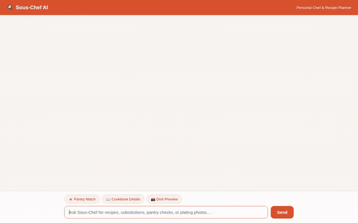

# Sous-Chef AI 🍳

A conversational AI sous-chef and recipe planner built on Google Cloud Agent Platform, powered by the Agent Development Kit (ADK) and Gemini 3.8 Flash.



---

## What It Does

Sous-Chef AI helps home cooks discover meals, cook from ingredients on hand, customize recipes for allergies and diets, and view AI-generated plating previews.

### Wired Tools & Capabilities

- **Vertex AI Memory Bank**: Long-term cross-session memory powered by `PreloadMemoryTool` and a turn callback (`add_session_to_memory`). Remembers user allergies, dietary restrictions (e.g. gluten-free, dairy-free), family size, and pantry preferences across conversations.
- **Cloud Firestore Recipe Cookbook**: Real-time cloud database storage (`qwiklabs-gcp-04-f6830db8354b`) for recipes. Supports browsing recipes (`list_recipes`), retrieving full culinary instructions and ingredient breakdowns (`get_recipe_details`), and saving new creations (`add_recipe`).
- **Pantry Matching & Shopping List**: Computes overlap between user pantry items and recipes (`check_pantry_match`), calculating match percentages, highlighting available ingredients, and generating missing grocery lists.
- **Dietary & Pantry Substitutions**: Intelligent ingredient replacement lookup (`find_ingredient_substitute`) providing culinary alternatives for dairy, egg, gluten, or missing kitchen staples.
- **Global Recipe Search**: Connects to the public TheMealDB API (`search_web_recipes`) to search global recipe archives by keyword with meal categories, instructions, and ingredients.
- **Food Photography & Cloud Storage**: Generates visual previews of dishes using `gemini-3.1-flash-lite-image` (`generate_recipe_image`). Automatically registers image artifacts in the ADK session and uploads image bytes to a public Google Cloud Storage bucket (`gs://sous-chef-ai-qwiklabs-04-media`), returning a direct public HTTPS URL.
- **Agent Platform Code Sandbox Execution**: Runs secure Python code via `AgentEngineSandboxCodeExecutor` on Google Cloud Agent Platform for serving scaling calculations, unit conversions, and culinary math.
- **A2A (Agent-to-Agent) Protocol & Web Frontend**: Exposes an A2A-compliant agent card and interacts with a custom FastAPI proxy and themed chat UI capable of rendering text and native A2UI component cards.

> **Status Note**: Serving scale calculator, nutritional macro computation, and prep timeline scheduler in code execution are supported via the integrated Agent Engine code sandbox. Additional offline features mentioned in early planning (such as local calendar sync) are planned, not yet implemented.

---

## Architecture

- **Agent Framework**: Google Agent Development Kit (`google-adk`)
- **Foundation Model**: `gemini-3.8-flash`
- **Image Generation Model**: `gemini-3.1-flash-lite-image` (global location)
- **Deployment Runtime**: Vertex AI Agent Engine / Agent Runtime (`us-east1`)
- **Protocol**: A2A (Agent-to-Agent)
- **Frontend**: FastAPI async proxy + HTML5/CSS3 custom branded chat interface

---

## Local Setup & Run

### Prerequisites

- Python 3.12+
- `uv` package manager
- Authenticated Google Cloud SDK (`gcloud auth application-default login`)

### 1. Install Dependencies

```bash
uv sync
```

### 2. Run Locally in Development UI

To launch the agent with local reloading and Vertex AI Memory Bank integration:

```bash
uv run adk web . --port 8080 --reload_agents --memory_service_uri=agentengine://<YOUR_AGENT_ENGINE_ID>
```

### 3. Run the Custom Frontend

From the `frontend/` directory:

```bash
cd frontend
pip install -r requirements.txt
export AGENT_ENGINE_RESOURCE_NAME="projects/<PROJECT_ID>/locations/<LOCATION>/reasoningEngines/<REASONING_ENGINE_ID>"
export AGENT_DIRECTORY="app"
python main.py
```

Open your browser to the local port indicated by uvicorn (e.g. `http://localhost:8080`).

---

## Deployment Instructions

### Deploy Agent to Agent Platform

```bash
agents-cli deploy --project <PROJECT_ID> --no-confirm-project
```

### Deploy Frontend to Cloud Run

```bash
cd frontend
gcloud run deploy sous-chef-frontend \
  --source . \
  --region us-east1 \
  --platform managed \
  --allow-unauthenticated \
  --set-env-vars="AGENT_ENGINE_RESOURCE_NAME=projects/<PROJECT_ID>/locations/us-east1/reasoningEngines/<REASONING_ENGINE_ID>,AGENT_DIRECTORY=app" \
  --project <PROJECT_ID>
```
